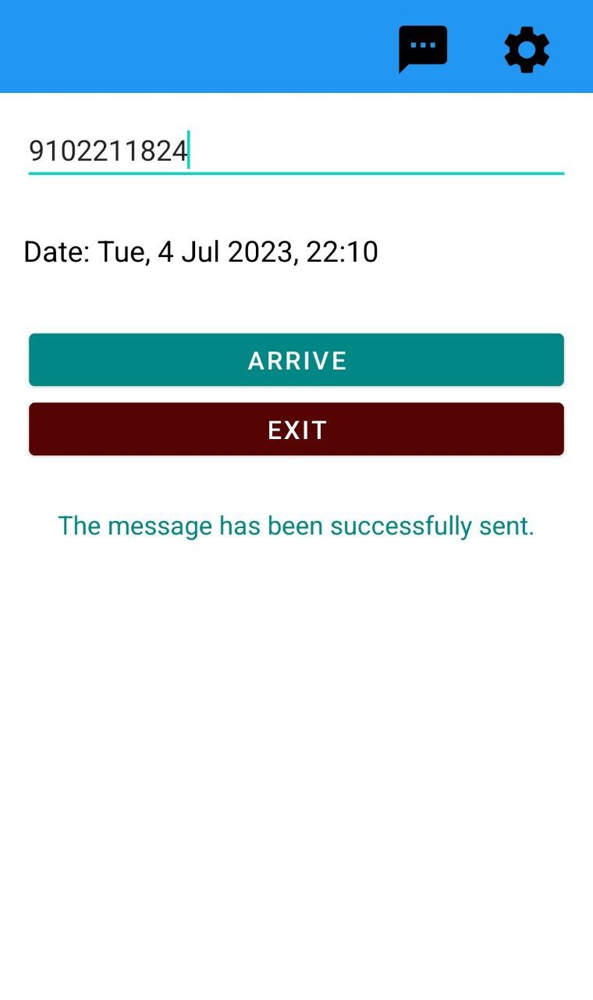
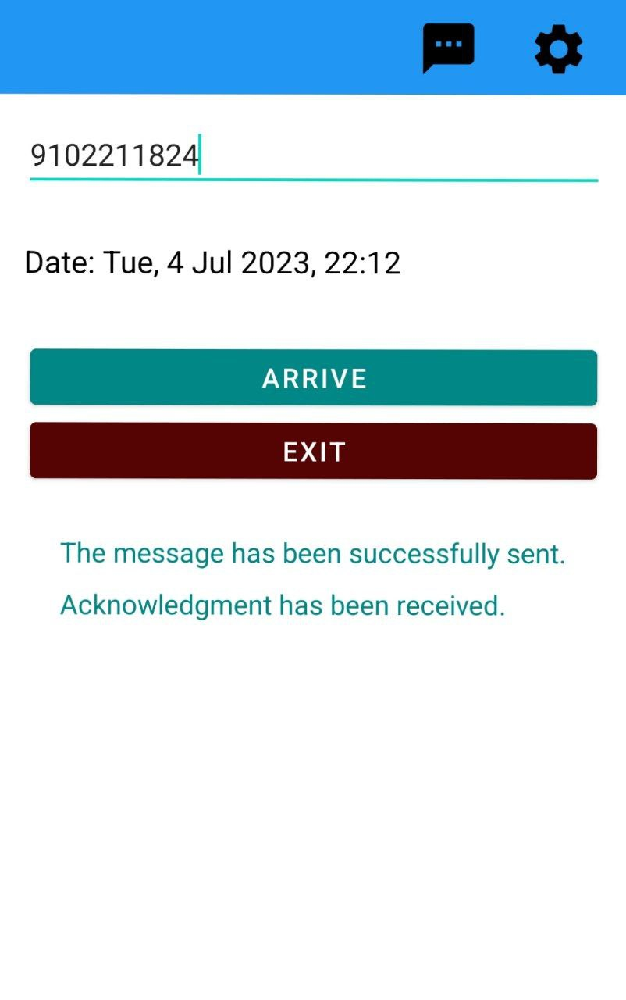
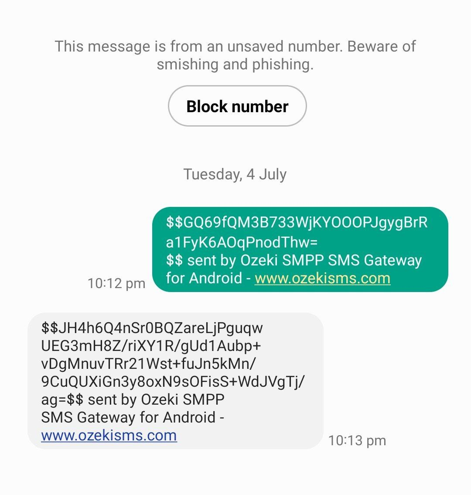
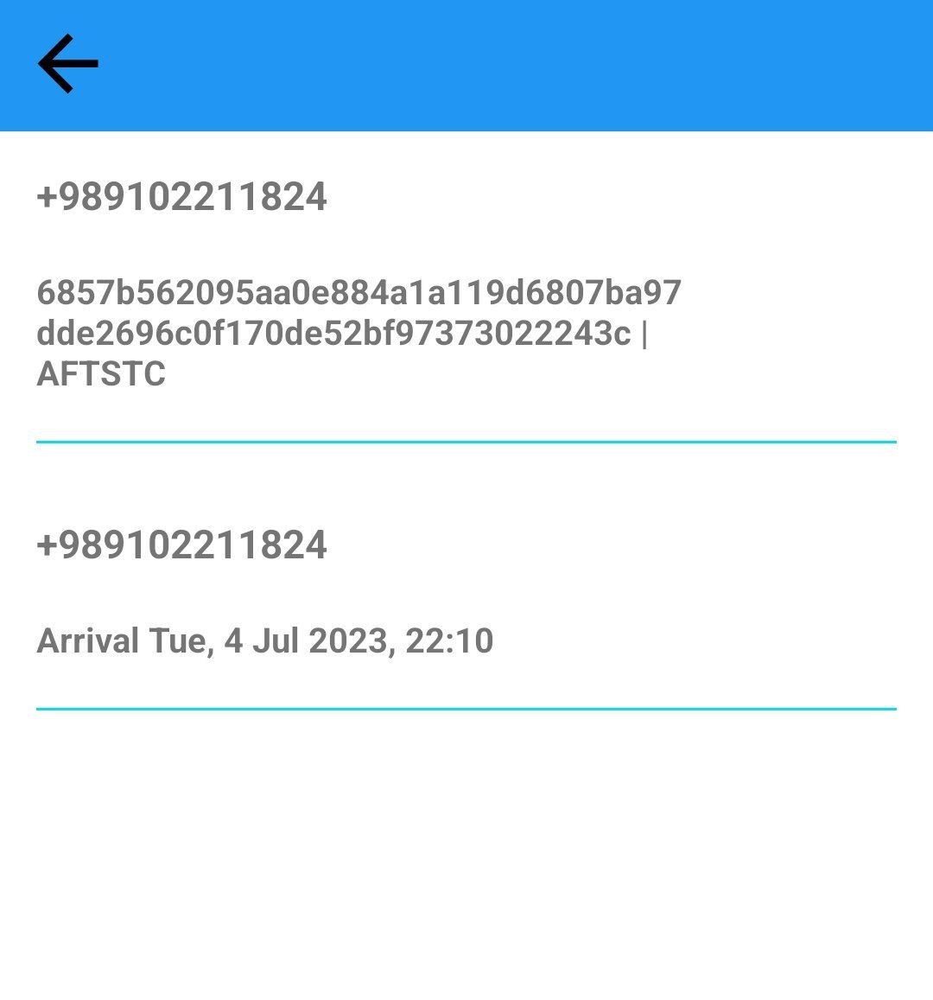
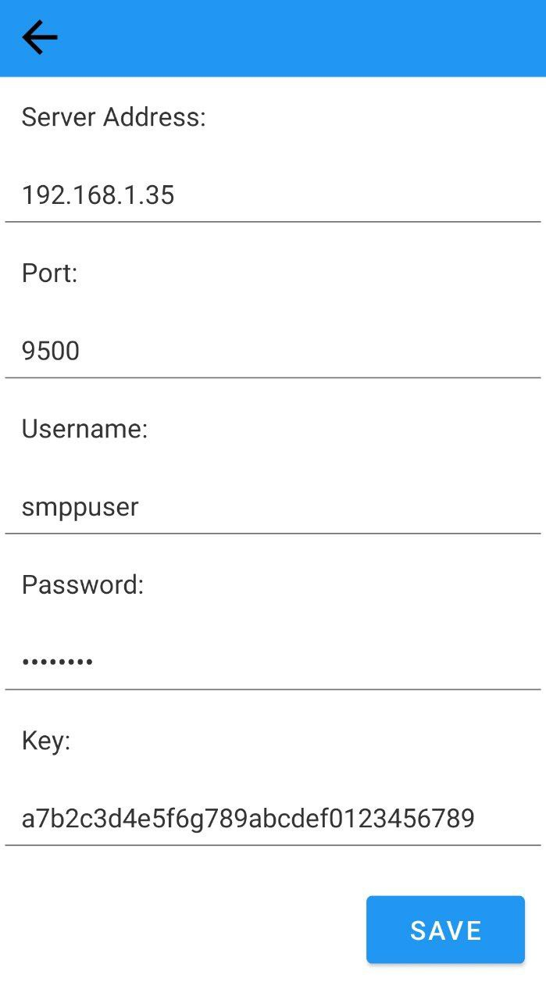
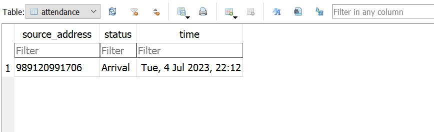

# Android Secure Message Protocol

An Android app that sends encrypted SMS through an SMPP gateway, then checks that the server received exactly what was sent.

[نسخه فارسی](README.fa.md)

Built with [samanmohammadraouf](https://github.com/samanmohammadraouf), who wrote the server: [SMPP_Server](https://github.com/samanmohammadraouf/SMPP_Server). The original repo is [samanmohammadraouf/AndroidSecureMessageProtocol](https://github.com/samanmohammadraouf/AndroidSecureMessageProtocol).

| Send a message | Ack received |
| :--: | :--: |
|  |  |

| Phone SMS app | Our inbox | Settings |
| :--: | :--: | :--: |
|  |  |  |

Server side:

## How it works

1. **Send.** You type a number and a message. The app encrypts the text with AES, wraps it in `$$` markers and sends it as an SMPP `SUBMIT_SM` through the gateway, using [Cloudhopper SMPP](https://github.com/twitter/cloudhopper-smpp).
2. **Ack.** The server decrypts the message and replies by SMS with the SHA-256 hash of the text. Replies that end with ` | AFTSTC` are acks.
3. **Check.** The app catches incoming SMS with a `BroadcastReceiver`, decrypts them and compares the hash in the ack with the hash of what it sent. If the hash and the number both match, the message is marked as delivered. If not, the app asks you to send it again, because the message may have been changed on the way.
4. **Inbox.** Sent and received messages are read from Android's SMS store, decrypted and shown as a chat.

Gateway host, port, username, password and the key are set once in Settings and kept in `SharedPreferences`.

At first we also received messages over SMPP, but the Ozeki gateway kept dropping the connection while it ran in the background. Receiving through a `BroadcastReceiver` fixed that.

## Try it

1. Install [Ozeki SMPP SMS Gateway Lite](https://github.com/samanmohammadraouf/AndroidSecureMessageProtocol/releases/download/v1/Ozeki_Smpp_Sms_Gateway_Lite.apk) on a phone and connect it.
2. Install [SmppClient](https://github.com/samanmohammadraouf/AndroidSecureMessageProtocol/releases/download/v1/SmppClient.apk) (this app) and enter the gateway details in Settings.
3. For the key, use your own or the demo key `a7b2c3d4e5f6g789abcdef0123456789`. The server has to use the same key.
4. Run [SMPP_Server](https://github.com/samanmohammadraouf/SMPP_Server).

## Code

| File | What it does |
| --- | --- |
| [Smpp.kt](app/src/main/java/com/example/testsmpp/Smpp.kt) | SMPP session and sending |
| [SMSReceiver.kt](app/src/main/java/com/example/testsmpp/SMSReceiver.kt) | Catches incoming SMS, decrypts them, spots acks |
| [SecurityUtil.kt](app/src/main/java/com/example/testsmpp/SecurityUtil.kt) | AES encryption and SHA-256 hashing |
| [MainActivity.kt](app/src/main/java/com/example/testsmpp/MainActivity.kt) | Send screen and the ack check |
| [SMSActivity.kt](app/src/main/java/com/example/testsmpp/SMSActivity.kt) | Inbox |
| [SettingsActivity.kt](app/src/main/java/com/example/testsmpp/SettingsActivity.kt) | Gateway and key settings |

Kotlin, Android 6.0 and up (min SDK 23).

## Known limits

This was a learning project, so the encryption is simple: AES in CBC mode with an all zero IV, and the key is used directly as bytes. A real version would use a random IV for every message and an authenticated mode such as AES GCM.
